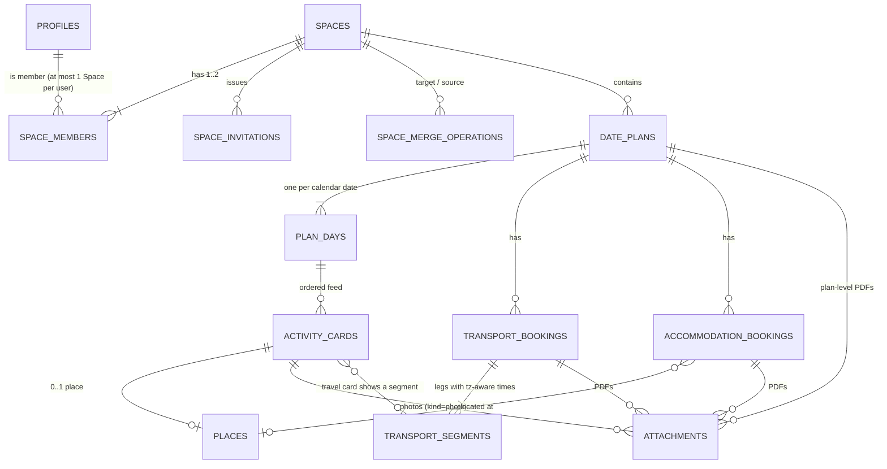

# 04 – Data model, Supabase access rules, concurrency, time, localization

Design only. No Supabase project, migration, or production change is created by this document.

## 1. Relationships

### 1.1 Tables (proposed columns; ids are `uuid`, all Space-owned tables carry `space_id`)
| Table | Key columns / constraints |
|---|---|
| `profiles` | `id` = `auth.users.id`, `display_name`, `locale` (default `en`), `home_time_zone` (IANA) |
| `spaces` | `id`, `name?`, `status` (`active`\|`merged`), `merged_into?`, `created_by`, `created_at`. Merged Spaces are **retained as tombstones**, never deleted by the app |
| `space_members` | `space_id`, `user_id` **UNIQUE** (one Space per user), `role` (`owner`\|`member`), `joined_at`. Trigger enforces ≤ 2 rows per Space under a row lock |
| `space_invitations` | `id`, `space_id`, `created_by`, `code_hash` (never the code), `status` (`pending`\|`accepted`\|`revoked`\|`expired`), `expires_at?` (U-04), `accepted_by?`, timestamps. Partial unique index: ≤ 1 `pending` per Space |
| `space_merge_operations` | `id` (client idempotency key), `invitation_id` UNIQUE, `source_space_id`, `target_space_id`, `actor_user_id`, `status` (`prepared`\|`completed`\|`rejected`), `disclosure_version`, `counts_before jsonb`, `counts_moved jsonb`, `error_code?`, timestamps |
| `date_plans` | `space_id`, `title`, `start_date date`, `end_date date` (CHECK `end_date >= start_date`), `notes`, `version`, `deleted_at?` |
| `plan_days` | `plan_id`, `space_id`, `day_date date`, UNIQUE(`plan_id`,`day_date`) |
| `activity_cards` | `plan_id`, `day_id`, `space_id`, `kind` (`note`\|`activity`\|`travel`), `position text` (fractional key), `title`, `body` (short, length-limited), `segment_id?`, `version`, `deleted_at?` |
| `places` | `space_id`, `name`, `address_text`, `latitude`, `longitude`, `provider?`, `provider_place_id?`; at most one per card (UNIQUE `card_id`) or linked from accommodation |
| `transport_bookings` | `plan_id`, `space_id`, `mode` (`train`\|`flight`\|`bus`\|`other`), `provider_name`, `booking_reference`, `notes`, `version` |
| `transport_segments` | `booking_id`, `space_id`, `origin_text`, `destination_text`, `departs_at timestamptz`, `departs_tz text`, `arrives_at timestamptz`, `arrives_tz text`, `sequence` |
| `accommodation_bookings` | `plan_id`, `space_id`, `name`, `place_id?`, `check_in_date date`, `check_out_date date`, `check_in_local_time time?`, `booking_reference`, `notes`, `version` |
| `attachments` | `id`, `space_id`, `kind` (`pdf`\|`photo`), `storage_bucket`, `storage_path` (**independent of `space_id`**), `original_filename`, `content_type`, `size_bytes`, `status` (`pending`\|`ready`\|`failed`), `uploaded_by`, exactly one owner FK non-null (CHECK): `plan_id` \| `card_id` \| `transport_booking_id` \| `accommodation_booking_id`, `position?` (photos) |

Booking references and similar are real personal data: stored only in the database (never source, Git, logs, fixtures, screenshots in the repo). Seed/test data uses obviously fake values.

### 1.2 Calendar dates vs. time-zone-aware times
* **Calendar dates** (`date_plans.start_date/end_date`, `plan_days.day_date`, `check_in/out_date`) are Postgres `date`, represented in Dart by a dedicated `CalendarDate{year,month,day}` value type (not `DateTime`). They have **no** time zone, are never converted, and never derive from a timestamp.
* **Travel times** are an instant (`timestamptz`) **plus the IANA zone of that endpoint** (`departs_tz`, `arrives_tz`). Display the wall time in the stored zone with the zone label; optionally add a secondary "your time" line for the viewer.
* A card belongs to a day by `day_id`, **not** by its timestamp, so overnight arrivals or viewer zone changes never move it. The UI may show "arrives +1 day (local)" as derived text only.
* Entry uses a zone-aware picker: ambiguous (DST overlap) or non-existent (DST gap) local times prompt the user rather than silently shifting.
* Accommodation check-in time is a *local wall time of the property* (`time`, no zone), not an instant.
* Calendar view: plan periods = all-day spans from dates; travel = timed markers from segments, positioned on the date of the **segment's own zone**. "Today" and plan status use the viewer's device local date (U-11 confirms).
* External personal-calendar events are never read, stored, or shown in the initial scope.

## 2. Authorization (Supabase layer)

### 2.1 Principles
1. Row Level Security **enabled on every table** (including `profiles`, invitation and merge tables); no table is readable via the anon role.
2. Membership test via `public.is_space_member(space_id uuid)` — `SECURITY DEFINER`, `STABLE`, fixed `search_path`, returns true iff `auth.uid()` has a row in `space_members` for that Space.
3. Policy pattern on Space-owned tables: `SELECT/INSERT/UPDATE/DELETE` all `USING/WITH CHECK (is_space_member(space_id))`; `INSERT/UPDATE` also guard that `space_id` equals the parent's `space_id` (constraint trigger) so a member cannot attach rows across Spaces.
4. `space_members` and `space_invitations` have **no direct client INSERT/UPDATE/DELETE**. Membership changes only through audited `SECURITY DEFINER` functions (doc 05), callable by `authenticated` only.
5. Service-role key is never shipped in the client; client uses the anon key + user JWT only. No secrets in source/Git/logs.
6. Space members can read `profiles` of their partner (display name only) via a policy joining `space_members`; users otherwise read/update only their own profile.

### 2.2 Private storage
* Two buckets, both **`public = false`**: `pdfs` (`application/pdf` only) and `photos` (JPEG only after client processing, see §6). **`file_size_limit` = 3 MiB on both (decided: 3 MiB = 3,145,728 bytes)**, enforced by Storage itself in addition to the client check.
* Object path = `<random uuid>/<uuid>.<ext>` — **contains no `space_id`** — so a Space merge never requires moving or renaming files or rewriting storage policies.
* `storage.objects` policies: `SELECT/INSERT/UPDATE/DELETE` allowed iff an `attachments` row with `storage_path = objects.name` exists whose `space_id` passes `is_space_member`. For INSERT the `attachments` row (`status='pending'`) is created first by the client under RLS, then the upload is authorized against it.
* Upload: client creates `attachments` row (pending) → uploads object → calls `finalize_attachment(id)` which verifies size/content type (PDF magic bytes `%PDF-` for kind=pdf) and sets `ready`; failures set `failed` and are retryable; orphaned files left by failed uploads: cleanup policy still open (U-07); nothing is auto-deleted until decided.
* **PDFs** are stored byte-for-byte; the app never rewrites, compresses, or replaces a PDF. A PDF over 3 MiB is rejected, not compressed.
* **Photos** ≤ 3 MiB are stored unchanged. Photos over 3 MiB are compressed on the device before upload and **only the compressed version is stored** (decided); see §6. Thumbnails are still open (U-08).

### 2.3 PDF preview and download (spec §7)
| Aspect | Design |
|---|---|
| Preview | On tap, client calls `create_attachment_access(attachment_id, purpose='preview')`. The function checks `is_space_member`, `status='ready'`, `kind='pdf'` and returns a **short-lived signed URL** (proposed TTL 60–300 s; U-06) without an attachment content-disposition. The client fetches the bytes into memory and renders with a render-only package (no PDF JavaScript execution; package choice U-03). **No Download/Save action precedes preview.** |
| Download/Save original | Separate button → `create_attachment_access(id, purpose='download')` → signed URL with `download=<original_filename>`; Android saves via share sheet/Storage Access Framework, web via browser download. Bytes are the unmodified original. |
| Authorization | Issued only after the membership check; non-members get 403 and no URL. Expired URL → client re-requests once, then shows the error state. |
| Privacy | Bucket stays private; signed URLs and tokens are never logged or persisted (logging redaction rule), never put in analytics or crash reports. Preview data is held in memory only; persistent device caching/offline = U-09. |
| Web specifics | Bucket CORS limited to the app origin(s); fetch for preview uses `fetch`→`Uint8List`. |
| Photos | Same mechanism (`purpose='view'`) with the same member-only checks. |

## 3. Concurrent editing, reordering, deletion
* **Optimistic concurrency:** editable rows carry `version bigint` (incremented by trigger). Client updates with `WHERE id=? AND version=?`; zero rows ⇒ conflict. UI `ConflictDialog` shows partner's latest values vs. the user's unsaved edits: *Keep mine* (resubmit on new version) / *Use theirs* / *Copy mine and use theirs*. Nothing is overwritten silently.
* **Reorder:** `position` is a fractional-index string. Reorder/move uses server function `move_activity_card(card_id, target_day_id, prev_id, next_id)` that computes the key under a row lock, so stale neighbor info never corrupts order and a concurrent text edit does not make the reorder fail. Ties are ordered by `(position, id)` deterministically. A server-side rebalance function (single transaction) runs when keys grow long.
* **Live updates:** Supabase Realtime subscription per open plan refreshes the feed; if the item being edited changes remotely, a non-blocking banner "Updated by your partner" is shown.
* **Remove:** user-facing remove sets `deleted_at` (soft delete) so edit-vs-delete races are recoverable (*Restore*). Hard purge of soft-deleted rows inside a live Space is **not performed** until U-07 is decided (they are purged only by the Space deletion in §5). Removing a plan/booking/card **must state what happens to attached files** (they stay stored and recoverable).
* **Shortening a plan's dates:** blocked while cards exist on days that would be dropped; user must move or explicitly remove those cards first.

## 4. Localization structure
* Flutter `gen_l10n`: `lib/l10n/app_en.arb` is the template; `app_de.arb` added later without code changes. All user-facing text — including validation, errors, disclosure text, status labels, semantics labels — uses `AppLocalizations`; no string literals in widgets (enforced by an automated test scanning `lib/` for widget text literals, with a reviewed allowlist).
* Keys `feature_screen_element` (e.g. `join_review_disclosure_body`). ICU plurals for counts; no sentence concatenation; placeholders for names/dates.
* Dates/times/numbers formatted with `intl` for the active locale; time-zone names from IANA data (`timezone` package, tz database bundled for web).
* Layouts tolerate ~35 % longer strings (German) and 200 % font scale; a pseudo-locale (`en_XA`, expanded text) is used in tests.
* Server errors return stable **error codes**, never user-facing text; client maps codes to localized messages.
* The disclosure text is versioned (`disclosure_version`) so what the user agreed to is recorded.
* Auth e-mail templates are localized later (note for U-01).

## 5. Leaving a Space, account deletion, permanent deletion (decided)
Rules given by the project owner: (1) a person who leaves loses access to the Space's data; (2) when both people have left, nobody owns the data; (3) data with no owner is deleted permanently; (4) deleting an account removes the profile only, and Space data is deleted only if it has no owner.

**Interpretation used here (decided: no export before leaving, deletion at once, remaining member becomes owner):** the data belongs to the *Space*; "owner" means "the Space still has at least one member". Items the leaver created stay in the Space for the remaining member and show "Former member" (`created_by` set to null).

| Action | Server behavior |
|---|---|
| Leave, Space has 2 members | Membership deleted; leaver instantly fails every RLS check and cannot obtain signed URLs; partner (becomes `owner`) keeps everything unchanged; pending invitations revoked; leaver may create a new empty Space or join another |
| Leave, last member | Space and **every** Space-owned row (incl. soft-deleted, tombstones, invitations, merge records) deleted in one transaction; storage paths written to `file_deletion_queue` in the **same transaction** |
| Delete account | Runs the matching leave action first, then removes profile and auth user. Shared data survives if a partner remains; if the user is the last member it is deleted as above |

Rules:
* `leave_space(operation_id, expected_member_count)` — idempotent via `operation_id`, locks the `spaces` row. If the real member count differs from `expected_member_count` (e.g. both leave at the same moment) nothing changes and the client must re-confirm, so nobody silently becomes "the last member".
* Storage files are not removed by deleting SQL rows. A server job (Edge Function with the service-role key, kept only as a server secret) drains `file_deletion_queue` through the Storage API with retries until empty. DB deletion never commits without queued file deletions, so files cannot be orphaned.
* UI: leaving shows exactly what the user loses; the last-member case lists counts (plans, files) and requires typing a confirmation word. Account deletion repeats this.
* **Permanent, at once (decided):** no grace period and no in-app recovery. Hosting backups may keep copies until they expire; the confirmation screen states this.
* No export-before-leaving exists in the initial app (decided).

## 6. Photo input (decided: defaults + paste + 3 MiB)
* Ways to add: gallery/file picker (multi-select), camera on Android, **copy & paste** (desktop web: paste into the focused card editor; Android app: *Paste photo* action reading the clipboard; Android mobile web: best-effort, verified per platform and recorded PASS/FAIL, not assumed).
* Accepted inputs (decided): JPEG, PNG, WebP, HEIC, BMP. The app converts every input to JPEG before upload (converting is allowed; stored photos are JPEG only). Image must decode; otherwise a localized error.
* HEIC decoding: Android decodes natively; browsers mostly cannot, so web needs a bundled decoder library (size/licence to check at S7). If HEIC conversion does not work on a platform, that platform reports FAIL for HEIC and shows a clear message; it is never claimed as working.
* ≤ 3 MiB: uploaded **unchanged**.
* Over 3 MiB: compress on device: apply orientation, downscale the long edge stepwise (e.g. 4096→3072→2048→1600 px) and lower JPEG quality (0.9→0.6) until ≤ 3 MiB; output JPEG (transparency flattened to white). User sees "Compressed from X MB to Y MB". If the limit cannot be reached at the minimum settings, the photo is rejected with a clear message.
* GPS location is not needed (decided): metadata, including GPS, is removed during conversion. No limit on photos per card is set (proposed default).
* Server never trusts the client: bucket limit, content-type and magic-byte check in `finalize_attachment`.
* PDFs: size is checked **before** upload ("This PDF is 4.2 MB; the limit is 3 MB"); no record is created for a rejected file.
